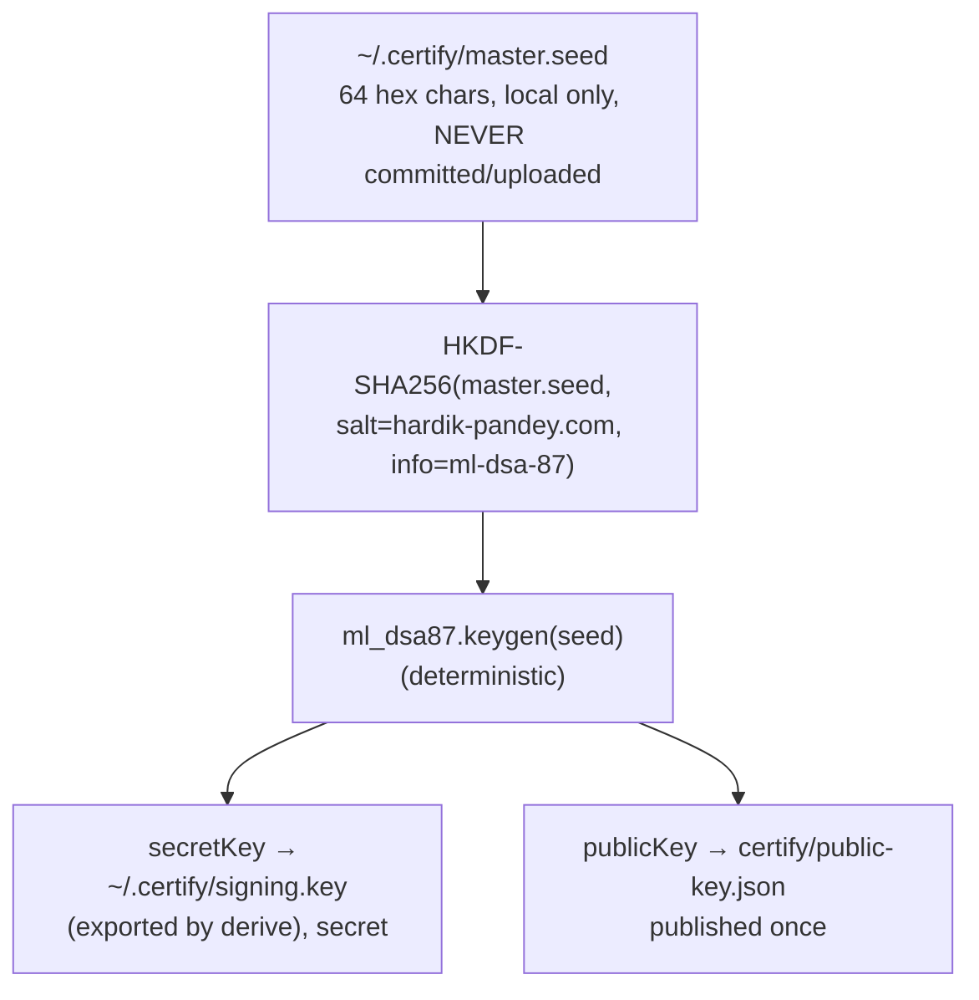

# Post-Quantum Certificates (certify/)

Signed **acknowledgement certificates** from hardik-pandey.com. When a security
report I receive is validated, a certificate is issued acknowledging it. Each
certificate is a small JSON file whose claims are protected by an **ML-DSA-87**
signature, the highest security level of NIST's **FIPS 204** post-quantum
signature standard.

Every certificate is verified **entirely in the browser** against a single
public key published once on this site. There is no backend, no database, and
nothing secret stored on the domain.

- **Verify a certificate:** `https://hardik-pandey.com/certify/verify.html`
- **Public key:** `public-key.json`

---

## Why post-quantum?

- Classical signatures (RSA, ECDSA/Ed25519) rest on factoring and discrete
  logarithms, problems a large-scale quantum computer can solve with **Shor's
  algorithm**. Post-quantum cryptography isn't about "bigger keys"; it is about
  the underlying problem being hard for quantum computers too.
- The threat isn't only future traffic. Attackers can already record today's
  signed data and break it later once a quantum computer exists
  (**"harvest now, decrypt later"**). PQC signatures close that window.
- NIST finalized **FIPS 204 (ML-DSA / Dilithium)** and **FIPS 205 (SLH-DSA)**,
  and has proposed prohibiting classical RSA/DSA in new systems. Building on
  ML-DSA is the forward-looking choice.
- ML-DSA is **lattice-based**: its security rests on the hardness of
  **Module-LWE**, for which no quantum speedup is known.
- **ML-DSA-87** targets NIST security category 5 (≈AES-256). Public key
  2,592 bytes, signature 4,595 bytes (plus 32 bytes hedged randomness).
- Browsers do **not** yet ship post-quantum algorithms in WebCrypto, so
  verification runs through `@noble/post-quantum`, a small, audited,
  pure-JavaScript implementation (no WASM), self-hosted on this site and
  pinned with SRI.

## How a certificate works

A certificate is a JSON object with two parts: the **claims** (what is being
stated) and the **signature** (the proof).

```json
{
  "v": 1,
  "id": "9f86d081884c7d65",
  "issuer": "hardik-pandey.com",
  "issuedAt": "2026-08-20",
  "subject": "Demo Recipient",
  "claim": "Sample certificate demonstrating the post-quantum verification system.",
  "sig": "<base64url ML-DSA-87 signature>"
}
```

### The signing order matters

The signature covers **the exact bytes** of the claims (nothing else):

1. `claims` = `{"v", "issuer", "issuedAt", "subject", "claim"}`, serialized as
   compact JSON, keys in this fixed order, no whitespace. (Byte-exactness is
   why `{"a":1}` and `{"a": 1}` are *different* messages.)
2. `id` = first **16 hex chars** of SHA-256(claims), the certificate's ID.
3. `sig` = ML-DSA-87 signature over those exact bytes.
4. The file is `claims + id + sig`.

The `id` is a **pointer, not a proof**. A signature verifies against the whole
message, so verification must rebuild the exact signed bytes, then check the
signature. The verifier also recomputes SHA-256(claims) and compares it to `id`,
so **tampering breaks both the hash check and the signature check**.

### What verification does

```
1. rebuild the canonical claims bytes
2. SHA-256(claims)[0:16] == id ?          (integrity)
3. ML-DSA-87.verify(sig, claims, pubkey)  (authenticity)
4. both pass → VALID
```

## The key model

One master secret produces the signing key deterministically, so a single
public key verifies every certificate, and either the master seed *or* the
derived signing key is enough to sign.



**Everything on this site is public on purpose.** The public key and every
certificate can be downloaded by anyone. That is safe because public keys only
*verify*: forging a certificate would require the secret key, which never
leaves the site owner's machine. An attacker who downloads every file on the
domain still cannot produce a valid signature.

**Back up `~/.certify/master.seed`.** It is the single point of failure: losing
it loses the signing key forever. `signing.key` is just an exported copy of the
derived key (regenerated by re-running `derive`), so the seed is the only thing
the site owner needs to protect. (The site owner can reuse the same seed across
multiple repos: each repo uses its own HKDF salt, so each gets a different
keypair.)

### Which key does the CLI use?

Every option below is just a different way to load the **same secret**, so any
of them signs certificates the published public key verifies:

| Invocation | What it uses |
| --- | --- |
| `--key derived` (default) | `~/.certify/signing.key`, the saved derived key |
| `--key master` | `~/.certify/master.seed`, re-derives the key on the fly |
| `--seed-file <path>` | The given 64-hex seed file, derives from it |
| `--key-file <path>` | The given 4896-byte signing key file |

Precedence: `--seed-file`/`--key-file` (mutually exclusive: using both is an
error) override `--key`. If `--key derived` is selected but
`~/.certify/signing.key` is missing, the CLI silently falls back to deriving
from the seed.

Because `signing.key` is deterministically derived from `master.seed`, all of
these produce the **identical keypair**, unless you point `--seed-file` at a
*different* seed, which yields a different identity that will **not** verify
against the published public key (intended only for testing other seeds).

### Honest limits

- **No revocation.** The public key is fixed, so a valid signature stays valid
  indefinitely. Removing a hosted `<id>.json` only stops new copies being
  served; anyone who already has the file can still verify it.
- **No identity proof.** A certificate proves *hardik-pandey.com signed this
  exact statement about this subject on this date*. It does not prove the
  person presenting it *is* that subject.

## File layout

```
certify/
├── index.html               Landing page explaining the system
├── verify.html              The verification tool (?id=, ?c=, or paste)
├── verify.js                Verification logic (textContent only, XSS-safe)
├── certify.css              Page styles + print rules (external, CSP-safe)
├── noble-post-quantum.js    Vendored PQ library (SRI-pinned)
├── qrcode.js                Vendored QR encoder for the certificate card (SRI-pinned)
├── public-key.json          The single public key (published once)
├── issued/
│   └── <id>.json            Minted certificates (the ledger, committed)
└── README.md                This file
```

## CLI usage

The minting tool is a **developer-only Node CLI** that lives in its own
repository, [`certify-cli`](https://github.com/Hardik-7892/certify-cli) (private).
It never ships, never runs on the server, and has nothing to do with the
deployed site (which stays zero-build and dependency-free).

### Setup

The master seed belongs to the site owner; the CLI never generates it. Clone the
CLI, install its dependencies, and run `init`, which interactively derives the
seed either from a **password** (scrypt, hidden input) or a pasted 64-hex seed:

```sh
git clone https://github.com/Hardik-7892/certify-cli
cd certify-cli
npm install
node issue-cert.js init        # y = password, N = paste a 64-hex seed
```

Point the CLI at this repo by setting the `CERTIFY_DIR` environment variable or
a local `config.json` (see the certify-cli README). `init` / `derive` reads
`~/.certify/master.seed`, derives the signing key, saves it to
`~/.certify/signing.key`, and writes `certify/public-key.json` into this repo.
Both are idempotent: re-running them re-derives the *same* keypair (verified
behavior). The seed never leaves `~/.certify`.

### Issue a certificate

```sh
node issue-cert.js sign --subject "Name" --claim "Claim text" [--key derived|master] [--seed-file <path> | --key-file <path>] [--issuedAt YYYY-MM-DD] [--publish]
```

Output:

```
Certificate ID : 5912f2524d3b2b62
Verify (short) : https://hardik-pandey.com/certify/verify.html?id=5912f2524d3b2b62
Verify (long)  : https://hardik-pandey.com/certify/verify.html?c=<base64url of the cert JSON>
```

- **`--key`** picks which key signs: `derived` (default, reads
  `~/.certify/signing.key`) or `master` (re-derives from the seed on the fly).
  Both produce certificates the same public key verifies (tested).
- **`--seed-file` / `--key-file`** sign with an explicit key file (a 64-hex
  seed or a 4896-byte signing key) instead of the defaults.

- **`--publish`** also writes `certify/issued/<id>.json` for the hosted short
  URL (`?id=`). That file is committed: one commit + deploy per hosted cert.
- Without `--publish`, you get the long `?c=` URL and the JSON to paste/email.
  Zero commits.

### Verify locally

```sh
node issue-cert.js verify --file certify/issued/<id>.json
# or
node issue-cert.js verify --data "<json>"
```

Output:

```
ID hash matches      : yes
Signature valid      : yes
Overall              : VALID
```

Tampering with any field flips both checks to **INVALID** (verified).

### Regenerate the vendored libraries

If you bump `@noble/post-quantum` or `qrcode-generator`:

```sh
cd certify-cli
npm run vendor:build
node check-sri.js        # verifies/pins the SRI hashes used in verify.html
```

## Dependencies

| Where | Dependency | Notes |
| --- | --- | --- |
| Deployed site | `@noble/post-quantum` | Vendored single-file bundle, SRI-pinned |
| Deployed site | `qrcode-generator` | Vendored single-file bundle, SRI-pinned |
| Dev CLI (`certify-cli`) | `@noble/post-quantum` | Signing + deterministic keygen |
| Dev CLI (`certify-cli`) | `qrcode-generator`, `esbuild` | QR encoding; bundling the vendored files |

The site itself remains **zero-framework, zero-build**: nothing in `certify/`
is fetched from a CDN, and the CSP is unchanged (`script-src 'self'`,
`connect-src 'self'`).

## Issuing a real certificate (checklist)

1. Confirm the report is genuinely validated (URL, reproduction, expected vs
   actual).
2. `node issue-cert.js sign --subject "<researcher name>" --claim "<specific validated finding>" --publish`
3. Verify the hosted URL locally.
4. Commit `certify/issued/<id>.json` and push.
5. Send the researcher the short URL (or the JSON + long URL).